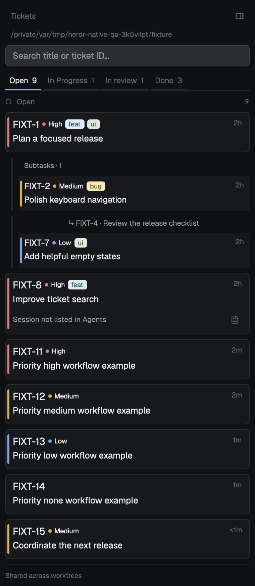

<div align="center">
  <h1>herdr-ticket</h1>
  <p><b>Tickets and session handoffs for the agents you run in Herdr.</b><br>
  Agents issue tickets, leave handoffs and pick up where the last session stopped; you see every ticket of the repository you are in, with the agent working on it, in a Herdr app panel.</p>

  <p>
    
    
    
    
    
  </p>
</div>

<p align="center"></p>

> **In development.** Expect rough edges and breaking changes before 1.0.

The interface, public documentation and distributed skill are in English. Ticket, document and handoff content follows your team's language; existing content is never translated automatically.

## One list per repository, from any worktree.

A ticket belongs to the repository's original main worktree. Issue it from `app.feat-login`, read it from `app` or `app.fix-build`: every worktree of a repository shares the same tickets, numbered `APP-1`, `APP-2`, …

New tickets snapshot their creation branch and absolute worktree path as `created_branch` and `created_worktree`. Later edits, status changes and handoffs do not move that origin. Detached HEAD has a null creation branch; tickets from before this feature keep both fields null. These fields appear on full ticket JSON (`new`, `show`, `brief`), not summary lists; the panel shows them after the expanded ticket's contents. A handoff's own `branch`/`worktree` still describes where that handoff was written.

## Agents and people use the same CLI.

`tk` is a small CLI with one SQLite file behind it. Agents boot with `tk brief`, issue tickets with `tk new`, move them with `tk status` and end a session with `tk handoff`. Every agent write names its provider and model, so you always know who wrote what; inside an agent a write without them is refused.

## Classify the work with tags.

Use tags such as `fix`, `feat` and `bug` to describe a ticket's nature without changing its workflow status. Names are free, not a fixed enum: each ticket accepts zero through eight unique names of 1–32 ASCII letters, digits or hyphens. Input is trimmed, lowercased and deduplicated in first-occurrence order. `Ticket.tags` stays a string array, with `[]` for an untagged ticket.

```sh
tk tags                            # reusable names and their colors in this repository
tk new "Fix save errors" --tags "bug,fix"
tk edit APP-12 --tags "feat,ui"
tk edit APP-12 --tags ""       # remove all tags
tk edit APP-12 --tags=--test   # equals syntax for a name beginning with --
```

`--tags` replaces the entire set on edit; omitting it preserves the set, and `--tags ""` clears it. New names register automatically in the same successful ticket write. Invalid saves leave no catalog entries behind. `tk tags --json` returns `{ repo, tags: [{ name, color }] }` in creation order.

The catalog belongs to the repository, shared across its worktrees. Definitions survive untagging and ticket deletion, so unused tags remain selectable. The first ten definitions get different colors; subsequent definitions cycle through the same fixed palette. Adding or removing tags from a ticket never recolors an existing definition.

New ticket and **More → Edit tags…** share a searchable, Notion-style multi-select: select/deselect existing names, remove selected chips, or type a new name and choose **Create**. Enter prefers an exact existing name over a partial match. New drafts preview the next palette color; saving persists ticket and catalog atomically, while cancel writes nothing. Removing all chips clears the ticket's tags. Draft colors use the currently loaded catalog; the saved catalog remains authoritative if another writer creates tags meanwhile.

Cards, selected chips and options use the same colored pills. Selected-chip and option lists are height-bounded and scrollable. Tag-name/color editing, deleting catalog definitions and ticket-list tag filters are not included.

## Prioritize without reordering.

Priority is optional: **High**, **Medium**, **Low**, or **None**. Existing and newly unspecified tickets remain `null`; nothing infers priority from tags or workflow state.

```sh
tk new "Fix a release blocker" --priority high
tk edit APP-12 --priority medium
tk edit APP-12 --priority=       # clear to None
```

Full tickets and summaries expose `priority: "high" | "medium" | "low" | null`. Omitting the flag on edit preserves it; invalid values reject the whole write. The creation dialog and **More → Priority…** use the same choices. Cards and child rows show a thin red/yellow/blue left marker with an English label, leaving their background, selection border, tags and session graphics intact. Editing priority preserves the linked session and unrelated ticket fields. List order and filters do not change.


## Split work into child tickets.

```sh
tk new "Handle payment errors" --parent APP-12 --tags fix
tk ls --parent APP-12
tk ls --parent APP-12 --status in_progress --terminal t7
```

A child is an independent ticket with its own ID, status, body, tags, session and handoffs. Parent and child must belong to the same repository; only one level is allowed, so a child cannot itself have children. Status changes do not propagate in either direction. Deleting a parent is refused while any child remains, including done or canceled children; nothing is cascade-deleted. This feature does not move existing tickets between parents.

Full tickets and summaries expose `parent_ref` (`null` for root and older tickets). `show` also returns `children`, a summary array across all statuses, including `[]` for a leaf. `--parent` combines with status/session filters but not `--all-repos`. The panel has **+ Add subtask** on root tickets and parent/child links that open repository-pinned details, including completed and canceled children.


## Handoffs that the next session can use.

A handoff has a one-line summary (200 characters at most) and four sections in a fixed order: `## Done`, `## In progress`, `## Blocked`, `## Next`. `tk` refuses anything else, so every handoff reads the same way. The branch and worktree it was written from are recorded with it.

## Keep repository documents beside the work.

`tk doc` manages repository-scoped **spec**, **adr**, and **note** documents, shared across worktrees. Document refs (`APP-D1`, or `D1` in that repository) use their own non-reused counter, independent of ticket numbers.

```sh
tk doc new "Repository decision records" --kind adr --body - --ticket APP-12
tk doc ls --kind adr --status accepted
tk doc show APP-D1 --history --pretty
tk doc edit APP-D1 --body -
tk doc status APP-D1 accepted
tk doc supersede APP-D1 --by APP-D2
tk doc link APP-D1 --ticket APP-13
tk doc unlink APP-D1 --ticket APP-13
```

ADRs start `proposed`; only proposed decisions can advance to `accepted` or `rejected`. Superseding requires two distinct accepted ADRs in the same repository and changes only the old one. Specs and notes have null status. Content and status changes save the preceding version, author and timestamp; creation metadata stays immutable.

Links are many-to-many within a repository. Creation with `--ticket` is atomic, while link/unlink leaves content version and ticket state alone. Deleting a ticket removes its associations, not documents. `show` and `brief` include lightweight `docs` summaries; list summaries remain ticket-only. Full content and opt-in history come from `doc show`. Existing ticket decisions and history are never converted automatically. Documents currently use the CLI, not a new panel tab.


## The agent on the ticket, one click away.

When an agent writes to a ticket from a Herdr terminal, that terminal is attached as its session. The panel mirrors a single native **Agents** entry instead of summarizing it as “Working · Oh My Pi”: the same program icon, space/tab/live-title rules, hover/focus, pin/fold controls, and status graphics. Working uses the app's spinning glyph; idle uses its gray ring. The same glyph also appears immediately left of the ticket ID. These are agent states, not ticket workflow transitions.

The linked session's current pane branch appears below its row. `Branch unavailable` means the live pane has no branch information; the panel never substitutes ticket creation or handoff metadata. An ended session is identified explicitly; a live terminal missing from Agents is identified as unlisted and can still be focused. State age is observed by this panel rather than copied from another mod's private history or the ticket attachment time.

The terminal-icon action (**Go / Start agent…**) opens a destination chooser: an existing live local agent in this repository (including its linked worktrees), a new Herdr tab in the original main worktree, or a new worktree and tab. A valid attached session is selected by default. Existing agents receive no prompt or model change; linking or launching does not infer ticket status.

New sessions offer **Claude Code**, **Codex**, and **Oh My Pi** from Herdr's registered, installed launchers. Enter a model ID, or leave it blank to preserve the configured launcher/CLI default. Oh My Pi accepts `provider/model` for an exact choice. Each runner keeps its own unsent draft; the command is captured before asynchronous destination work and locked once attempted. Executables named `claude`, `codex`, or `omp` are supported, including absolute paths; shell wrappers are not guessed or replaced with Claude. A launcher-discovery failure blocks new launches, not existing-session linking.

New worktrees follow Herdr's `~/.herdr/worktrees/<repo>/<branch-slug>` convention: an existing local branch uses its own commit; a new branch starts at the original main worktree's committed HEAD. Uncommitted changes are not copied. Errors retain the dialog and identify any created worktree/session; a known session whose link failed can be linked again without launching a duplicate. Agents without a verifiable live pane folder and remote spaces are not offered.

The linked session's **Prompts** action uses the separate [Prompt Jump](https://github.com/doominkim/herdr-prompt-jump) mod through its public shared-state request. The receiver owns supported-agent detection, panel visibility and target pinning; the action never retargets the focused pane. Missing installation and ended sessions show a warning. Keep Prompt Jump's always-visible relay configured so the first request can also open a panel that has never started.


## In the Herdr app

The 380px panel follows the focused pane's repository. Four disjoint filters are **Open** (`todo`), **In Progress** (`in_progress`), **In review** (`in_review`), and **Done** (`done`). Search matches ticket titles or IDs, ignoring case; filter counts remain repository-wide rather than changing with the search. The CLI's `brief` still includes review work.

The panel uses Herdr's `chrome`, native UI font and dim 11.5px **Tickets** section header in both light and dark themes. The ticket-outline icon creates a ticket; terminal and next-status icons expose their actions through accessible labels and tooltips. Ticket IDs are bold, with wrapping tag badges beside them; titles expand from a two-line preview. The upper right shows creation age (`<1m`, `1m`, `2h`, `3d`), refreshed every 30 seconds, with the exact local timestamp in a tooltip. This uses `created_at`, not the last edit or session time.

Expand a ticket once to read its complete body and newest handoff as native Markdown, with session and creation metadata visible without additional disclosures. Actions stay above the contents, and the list scrolls for long descriptions. Existing ticket bodies remain unchanged.

Within each status group, siblings sit below their parent with an indented connecting line and row dividers, rather than repeated card outlines. If the parent is outside the selected filter or search, its ref and available title provide context without adding it to the results or counts. Open its pinned details to read it in full. Expanded parents list only children outside the current list; pinned parent details still include children of every status.

**More → Copy full context (Markdown)** copies the current ID/title, status, tags, priority, parent/children, body and newest handoff, without older history; **Copy ID** copies only the ref. You can advance status or edit tags as before. **More → Delete ticket…** opens a confirmation naming the ticket and warning that its handoffs and history are permanently removed; parents with children are blocked. Controls use native keyboard-focusable buttons and the app's theme.

**More → Edit ticket…** opens a repository-pinned title/description editor for a root or child ticket, including pinned details. It loads fresh content, saves only changed fields, and keeps the linked agent unchanged. Save or ⌘Enter submits; Cancel/Escape discards an unsent draft. Blank titles are rejected, empty bodies are allowed, and errors retain the draft. Pending saves cannot be submitted twice or canceled.

The editor uses literal `--title=...` and `--body=...` flags so Markdown front matter and other values starting with `--` are preserved. `tk edit APP-12 --body=` clears a body; `--body=-` stores a literal dash, while separated `--body -` still reads stdin. New-ticket descriptions are also sent literally. Install this panel and its matching CLI together. Agent CLI session attachment keeps its behavior; the panel's content and priority editors suppress automatic terminal attachment.

## Install

Requires [Bun](https://bun.sh) 1.1 or later and git.

```sh
git clone https://github.com/doominkim/herdr-ticket
cd herdr-ticket
bun install
bun run build && cp dist/tk ~/.local/bin/tk
```

### The Herdr app panel

Ask the agent in your Herdr window to *add the mod at github.com/doominkim/herdr-ticket/tree/main/mods/herdr-ticket*, or run `./install-mod.sh` from the clone. The panel appears on the right the first time. It runs `~/.local/bin/tk`.

The CLI upgrades the database when it is opened, including by read commands. Schema 9 adds the repository tag catalog, schema 10 adds repository documents/history/links and their counter, and schema 11 adds nullable priority. Existing tickets, tags, origin, decisions and history are preserved; old priorities stay null. Before replacing an installed CLI, obtain approval and a consistent `tickets.db` backup, then apply matching CLI/mod upgrades together.

Fresh database creation serializes publication and temporary-link cleanup through a persistent `tickets.db.init` SQLite bootstrap lock. Keep this companion file in place: deleting a live lock inode defeats cross-process exclusion. Existing single-name databases bypass bootstrap. A matching interrupted `tickets.db.init-tmp` alias is recovered under the lock; unrelated hard links are rejected rather than removed.

Workflow ticket-ID prefixes require a separately approved, always-shown empty floating role; the installer does not mount it automatically. Append this to your personal layout's root `floating` array without replacing its other entries:

```json
{ "id": "ticket-label-runtime", "edge": "bottom", "align": "end",
  "content": { "mod": "herdr-ticket", "props": { "role": "label-runtime" } } }
```

The runtime prefixes local tabs with every exact-session-linked `in_progress` ticket ID, deduplicated and numerically ordered, while preserving manual and automatic names. It waits for native snapshots to acknowledge queued renames and coordinates multiple copies through shared ownership and a writer lease. Completion restores the original/manual name; automatic names are restored with `name: ""`, not a frozen tab number. Before removing the runtime, let it restore any names it owns.


To show and hide it with a key, give its layout block an id (`"id": "ticket"`) in `~/.config/herdr-app/layouts/<your layout>.json` and bind the toggle in `~/.config/herdr-app/keys.json`:

```json
{ "global": { "f6": "layout.toggle:ticket" } }
```

### Teach your agents

`skill/using-herdr-ticket/SKILL.md` is an agent skill: when to issue a ticket, the status rules, and the handoff format. Copy it into your agent's skills folder (for Claude Code, `~/.claude/skills/using-herdr-ticket/`).

## Commands

| Command | Does |
|---|---|
| `tk brief` | Open tickets of this repository, each with its latest handoff |
| `tk tags` | Reusable tag names and their stable colors for this repository |
| `tk new <title> [--body -] [--tags bug,fix] [--priority P] [--parent REF]` | Issue an independent ticket (todo), optionally under a root parent |
| `tk ls [--status S] [--terminal T] [--parent REF] [--all-repos]` | List summaries; parent combines with status/session, not all-repos |
| `tk show <ref> [--latest-handoff]` | Ticket body/current state and newest handoff in text; JSON includes all events/handoffs unless `--latest-handoff` is set |
| `tk status <ref> <status>` | `todo`, `in_progress`, `in_review`, `done` or `canceled` |
| `tk edit <ref> [--title T] [--body -] [--tags bug,fix] [--priority P]` | Change title, body, tags or optional priority |
| `tk handoff <ref> --summary S --body -` | Leave a handoff |
| `tk link <ref> --terminal T` | Attach a Herdr terminal as the ticket's session |
| `tk delete <ref> --yes` | Remove a ticket with its handoffs/history; blocked while children exist; numbers are not reused |
| `tk doc new/ls/show/edit/status/supersede/link/unlink` | Repository documents, immutable origin, revision history and ticket links |
| `tk repo [slug NEW]` | This repository's slug (2–10 uppercase letters or digits) |

`<ref>` is `APP-12`, or `12` for the repository you are in. `--body -` reads standard input, `--json` prints compact JSON, `--pretty` prints indented JSON (and implies `--json`), and `--cwd DIR` acts as if run in `DIR`. Agents add `--provider P --model M [--session S]` to every write. `tk help` has the full list.

### Reading tickets efficiently

- `tk ls --json` keeps the `{ repo, tickets }` wrapper. Each ticket is a summary with `ref`, `parent_ref`, `repo_root`, `number`, `title`, `status`, `tags`, `priority`, `session` (or `null`), `created_at` and `updated_at`; bodies, author/model metadata and history are omitted. `--all-repos` makes `repo` null while each summary keeps its own `repo_root`.
- `tk show APP-12` already shows only the newest handoff in text. Default `tk show APP-12 --json` still returns the full ticket, all `events` and all `handoffs` (newest first).
- `tk show APP-12 --latest-handoff --pretty` returns the full current ticket/body, `children` and `docs` summaries, and a `handoffs` array containing only the newest handoff, or `[]` if none exists. The `events` field is omitted. Older handoffs and event history are not fetched.
- `tk brief --json` keeps full open tickets, including creation origin and `parent_ref`, and `latest_handoff` (or `null`). The panel reads `show --latest-handoff` only for the expanded ticket to obtain children; collapsed cards remain lightweight. Repository-pinned details also read that one ticket.

```sh
tk ls --status in_progress --pretty
tk show APP-12 --latest-handoff --pretty
tk show APP-12 --json  # full events and handoff history
```

Everything lives in `~/.local/share/herdr-ticket/tickets.db` (or `$HERDR_TICKET_DB`).

## Develop

```sh
bun test
bun run build
```

## License

MIT
