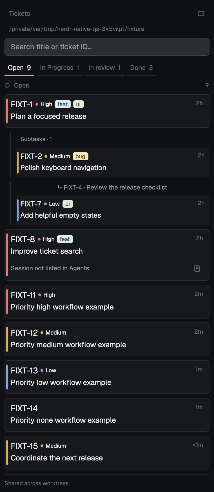

# herdr-ticket

A 380px repository ticket panel beside the focused terminal. Scan parent/child groups and explicit session states, expand once to read the body and latest handoff, and keep completed work behind a separate filter.

The screenshot is captured from the native panel with English sample tickets, priorities and grouped subtasks.

## What you see

- A 380px block on the right (`place: right`), native `chrome` background, 8px padding and inherited UI font at 13px.
- Header: a dim 11.5px **Tickets** section label, a 26px ticket-outline icon button, then the main worktree path at 10.5px with a full-path tooltip. The header follows the same spacing and theme tokens as Spaces/Agents.
- Search: a native input matching title or ticket ID, ignoring case and surrounding whitespace.
- Four disjoint filters: **Open** (`todo`), **In Progress** (`in_progress`), **In review** (`in_review`), **Done** (`done`), each with its unsearched repository-wide count. Within a status group, families follow their first visible ticket's number; siblings stay together in ascending number order. A contextual parent outside the filter is not a result and does not affect counts. Canceled tickets stay out of the main lists but remain readable through child links.
- A root ticket: a surface card with a 1px border (accent when expanded), the linked agent's native status glyph immediately left of its 14.5px bold UI-font ref, and wrapping colored tags beside it, above a 13px semibold title. Children use compact rows under a shared connecting line, with 13px refs, 12.5px titles and horizontal dividers instead of individual card outlines. Collapsed titles show at most two lines; a tooltip and the expanded title expose the full text.
- The upper-right creation age uses `created_at`: `<1m`, `1m`, `2h`, `3d`, with an exact local timestamp tooltip. Future clock skew clamps to `<1m`; a 30-second timer refreshes it. Tags remain independent of workflow status.
- Optional priority: High/Medium/Low use a thin red/yellow/blue internal left marker and a text label on cards, child rows and pinned details. None leaves the existing appearance alone; priority never changes list order. Light/dark contrast follows the resolved app background, including layout-specific themes whose appearance differs from the shell context.
- Session row: mirrors the native Agents item (16px program icon, 30px row, 8px horizontal padding, 9px gaps, 8px radius, 13px text), using its space/tab/live-title rules rather than “Working · program name”. Working uses the original `spinner.svg`, `t.working`, and 900ms spin; idle uses the original 7px/1.5px ring, with native done/blocked graphics. Hover pin, child fold/peek and focused styling match Agents. The current branch of that exact session's pane sits below the row; missing information is `Branch unavailable`, never inferred from another pane or creation/handoff metadata. Ended and live-unlisted sessions are explicit; live-unlisted terminals remain focusable. Age tracks this panel's observation of state changes, not attachment age or another mod's private cache.
- Expanded ticket: one expansion shows the complete body and latest handoff summary/body as native Markdown, preserving arbitrary sections and checklists. There are no nested Goal/Handoff disclosures and no raised handoff-summary box. Branch and provider/model metadata follow the handoff body.
- **Created in** follows the contents and shows the immutable creation branch and worktree path, with full-value tooltips. Detached creation shows `(detached HEAD)`; older tickets show `Unknown` rather than inferring their origin from a later handoff. This metadata stays out of collapsed rows.
- Icon actions sit above expanded contents: terminal (**Go / Start agent…**), next-status chevron/check, and **More**. More contains **Copy full context (Markdown)**, **Copy ID**, **Edit ticket…**, **Edit tags…**, **Priority…** and **Delete ticket…**. Root tickets additionally expose **+ Add subtask** and outside-list children; pinned parent details show all children. Child tickets expose a parent link. Native buttons are keyboard-focusable and show focus styling.
- Empty repository and no search results have distinct messages; Clear search and New ticket remain actionable. The footer says **Shared across worktrees**.

## How it behaves

- The panel follows the focused pane's folder. When that folder is outside any git repository, it shows the repository of the ticket the focused terminal works on; otherwise "Not in a git repository".
- Every 2 s it reads `tk rev` and reloads when that number or focus changes, or a catalog load needs recovery. A temporary tag-catalog failure is retried by the existing poll even without a new revision. Agent/pane snapshots are read once per render and remain independent of ticket writes.
- Clicking a ticket's title expands or folds it. The status button moves todo → in_progress → in_review → done.
- **Go / Start agent…** opens a 600×750 destination chooser. It verifies Git common-directory identity against live local agent pane folders, includes linked worktrees and selects a valid attached session by default. Existing agents are linked and focused without sending input or changing models. New tabs/worktrees choose registered, installed Claude Code, Codex or Oh My Pi launchers and an optional model ID; blank preserves configured defaults, with separate unsent drafts per runner. The command is captured before asynchronous repository/worktree checks and locked once attempted. Changing focus cannot retarget the captured repository/space. Launching/linking does not change workflow status.
- New worktrees use `~/.herdr/worktrees/<repo>/<branch-slug>`. An existing local branch retains its commit; a new branch starts at the original main worktree's HEAD. The dialog previews the path and warns that uncommitted changes are not copied. Failures preserve created resource information; retrying a known session link does not duplicate the launch. Uncertain launch/worktree results require inspection rather than blind repetition.
- **More → Copy full context (Markdown)** reads fresh `show --latest-handoff` and copies ID/title, status, tags, priority, parent/children, body and the newest handoff only. **Copy ID** copies the ref. Both use the native context's clipboard API and report failures rather than claiming success.
- **+ Add subtask** opens New ticket with a fixed parent. A subtask has its own ID/state/tags/session/body/handoffs; there is only one child level and no automatic parent/child state propagation. Parent and child links open a detail dialog pinned to the original repository, including done/canceled children. Parents with any children cannot be deleted.
- **More → Delete ticket…** opens a 420×260 modal naming the ticket and warning that its handoffs and history cannot be recovered. Cancel is initially focused; Escape cancels before submission. Confirm runs `tk delete --yes`; while pending, repeat submission and cancel are disabled. Errors stay in the dialog; the CLI rechecks the child-deletion guard atomically.
- **More → Edit tags…** opens a 520×520 repository-pinned multi-select dialog, with the ticket's names selected. Search existing definitions, toggle options, remove chips, or create an unknown valid name. Enter resolves an exact existing match before an earlier partial match. Save replaces tags; removing all clears them. Errors retain the draft; cancel does not register anything; pending saves cannot submit twice.
- **More → Edit ticket…** opens a 640×600 repository-pinned title/description dialog. It fetches fresh `show --latest-handoff` content and saves only changed fields with literal `--title=` / `--body=` flags. Save/⌘Enter submits; Cancel/Escape discards an unsent draft. Empty titles are rejected and empty bodies clear content. Errors keep the draft; loading disables Save, and pending saves disable fields, Save and Cancel. A no-op save closes without writing. Status, tags, parent, creation origin and the linked agent stay unchanged.
- **More → Priority…** opens a fresh, repository-pinned 440×300 dialog. High/Medium/Low/None saves only `priority`; no-op/Cancel/Escape write nothing. Pending changes cannot be duplicated or canceled, and errors retain the selection. The linked agent and all other fields stay unchanged.
- The ticket-outline **New ticket** button opens a centered dialog (640×720, modal): slug/path, title, optional priority, tags and a description prefilled with `## Goal` / `## Done when`. Esc/Cancel closes before submission; ⌘Enter/Issue issues the ticket. The untouched template is left to `tk`; other descriptions use literal equals-form text flags.
- Names retain the CLI's 0–8 unique / 1–32 ASCII letters-digits-hyphens rules. Catalog entries and their colors persist after untagging or ticket deletion. Ten colors cycle in definition-creation order; drafts preview from the loaded catalog, and the successful server save establishes the final color. Chip and option lists scroll within bounded heights; all three pill surfaces share the same styling.
- Search/filter/draft changes are local UI state. Switching repositories clears search, filters and the expanded ticket. A child-only result shows a parent-context link (ref and available title), including when the parent is in another state or absent from the loaded summaries. Other UI colors follow the app theme; tag pills intentionally use a fixed readable pastel palette, with no separate theme setting.
- A session's **Prompts** icon and the live-unlisted session action send the exact terminal plus a unique nonce to `prompt-jump.open`. Installation is checked through `appHome`, and liveness is rechecked after the read. The receiver owns support/pinning/visibility; missing/ended sessions warn. Prompt Jump's always-visible relay is required for cold opening.

## Built from

- One mod, `mods/herdr-ticket/`, with panel, new-ticket, content/tag/priority editors, delete confirmation, agent chooser and pinned-detail roles. `priority.js` owns optional priority controls; list/context/CLI/model modules keep their existing responsibilities. `sessions.js`/`session-data.js` mirror native rows and bridge Prompt Jump. The installer copies all JavaScript/SVG assets. No layout of its own.
- Data comes from `~/.local/bin/tk`. Main-panel reads include `rev`, `repo`, `brief`, `ls --status done`, one expanded `show --latest-handoff`, and `tags` once per repository/revision. Each tag modal separately reads its pinned catalog once. Failed catalog reads do not become successful cache entries. `new/edit --tags` registers unknown names atomically; `show` carries children and `new/ls --parent` preserve child workflows. Read commands can trigger schema upgrades.
- Revision checks run every second and reload content only after a revision/context change, leaving time for CLI reads inside the two-second refresh target.
- Content and priority editors suppress automatic session attachment through `/usr/bin/env -u HC_TERMINAL_ID` for those calls only. Other CLI and panel actions keep existing attachment behavior. Literal text uses `--body=-` for a dash, separated `--body -` for stdin, and `--body=` to clear.
- New sessions use core labels to join the captured space/tab; existing selection validates live repository identity. Tab names start from the title baseline. The optional, always-shown `label-runtime` floating role adds all active linked ticket IDs, commits ownership before queued commands, and confirms changes through later native snapshots. It does not depend on the hidden main panel starting.
- `gpui-base` native `Button`, `InputState` + `Input`, `TextareaState` + `Textarea`, and `TextView.markdown`. Session program icons follow the app's program table. The panel releases its retained search input when closed.

## Watch out

- The mod runs `~/.local/bin/tk`; install the CLI there first.
- A terminal's reported folder is where it started; an agent started in a parent folder and `cd`-ing into a repo is found through its linked ticket, not its folder.
- Sessions attach when `tk` runs inside a Herdr terminal (`HC_TERMINAL_ID`); agents started elsewhere show no session until linked.
- New launches require a supported registered `claude`, `codex`, or `omp` executable, including an absolute path. Explicit models replace its configured model options; blank leaves the registered command unchanged. Discovery errors do not disable existing-session linking.
- Only local machines: remote spaces are not handled.
- The installer does not activate session naming. Mount the empty `label-runtime` floating role only after explicit approval; preserve existing floating entries. Multiple copies share a bounded writer lease. Let the runtime restore owned names before removing it.

## Done when

- Open, In Progress, In review and Done select exactly their own canonical status. Search matches title/ID and leaves counts unchanged. Siblings form one family per status group without duplicated or hidden results, even when their parent is outside the filter. Empty and unmatched searches show their own recovery actions.
- Root cards, compact child rows, adjacent wrapping tags and top-right creation ages fit the 380px panel. Titles wrap to two lines when collapsed and show fully when expanded; full timestamps remain available in tooltips. One expansion exposes body, handoff and metadata without extra toggles, with scroll access to long contents.
- Copy ID and fresh Markdown context work; the latter includes the newest handoff and excludes old history. Clipboard/read failures do not display success.
- Title/body editing loads current content, stays pinned while focus changes, preserves unrelated fields and the linked agent, and refreshes through the normal revision poll. No-op/Cancel/Escape write nothing; blank titles reject, literal `--`/`=`/single-dash text and empty bodies round-trip; failures retain drafts and pending submissions cannot duplicate writes.
- A ticket issued with `tk new` in another terminal of the same repository appears within 2 s. One-level child creation, parent links and all-state child summaries work; root/child state changes remain independent and any child blocks parent deletion.
- Existing-agent selection excludes foreign/nested repositories, remote and ended agents, never launches a new model and stays usable when launcher discovery fails. All three new runners preserve explicit/default model argv in captured tabs/worktrees. Uncommitted changes stay out of a new worktree, launch/link failures retain resource information, and duplicate submissions do not create extra agents.
- Delete is behind More and a confirmation dialog. Cancel/Escape do not delete; a failed confirmation remains retryable and a pending one cannot submit twice.
- Tags retain catalog colors across cards, selection and options. Existing names are searchable, new drafts preview color immediately, exact-name Enter works, and cancel creates no definition. Clearing/deleting tickets leaves reusable definitions intact. Invalid saves preserve prior data, transient catalog failures recover, and concurrent writers do not allocate conflicting slots.
- `herdr-app check mods/herdr-ticket` passes.
